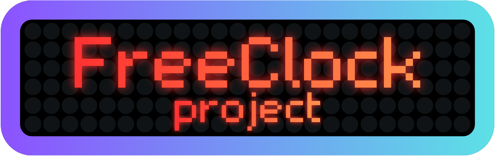
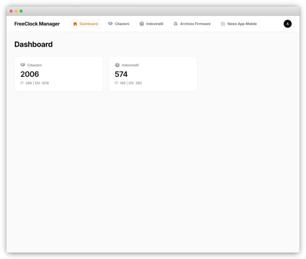

<div align= "center">

⭐ **Se ti piace questo progetto, metti una stella al repository!** ⭐ <br>
------- 🇬🇧 **[Readme in Inglese][readme-en-url]** 🇬🇧 --------

<hr />
</div>

<div align="center">
<h2>FreeClock Manager</h2>

[](#)
[](#)
[](#)

<hr/>

<a href="https://github.com/Matese-Makers/FreeClock">

</a>

<p><em>Questo software fa parte del progetto <a href="https://github.com/Matese-Makers/FreeClock"><strong>FreeClock</strong></a> — un orologio smart open source facile da assemblare, con un guscio stampabile in 3D e un'app mobile per la gestione. Costruiscilo anche tu ed entra a far parte del progetto!</em></p>



</div>

## 💡 Overview

FreeClock Manager è una web app per la gestione e distribuzione di **citazioni** e **indovinelli** tramite API.\
Viene utilizzato per il **progetto FreeClock**, dove gestisce sia l'aggiornamento OTA del dispositvo sia le news
dell'app mobile... ma può essere utilizzato anche standalone per i propri progetti.

### 🌍 Supporto Multilingua
- 🇮🇹 Italiano (lingua predefinita)
- 🇬🇧 Inglese
- 🔄 Citazioni e indovinelli filtrati per lingua (colonna `locale` sulle categorie)
- 🔄 Firmware e News traducibili tramite `spatie/laravel-translatable`
- 🗂️ Tab traduzione nel pannello admin (Filament Translatable Tabs)
- 🔗 API con supporto parametro lingua (italiana di default)

### 🛡️ Pannello Admin (Filament v3)
- 🔐 Login con restrizione dominio email configurabile
- 🎨 Tema ambra con navigazione top
- 📊 Widget dashboard con conteggio citazioni e indovinelli per lingua
- 🔍 Ricerca, filtri e ordinamento su tutte le risorse
- 🗑️ Azioni bulk (eliminazione multipla)
- 📝 Rich Text Editor con toolbar personalizzata

### 💬 Gestione Citazioni
- 📚 Archivio citazioni con CRUD completo
- 🏷️ Categorie con assegnazione lingua
- 📆 Pianificazione citazione giornaliera per data e lingua
- 🔁 Nessuna ripetizione nell'arco dell'anno solare
- 🔎 Filtri per categoria e lingua

### 🧩 Gestione Indovinelli
- 📚 Archivio indovinelli (testo + risposta) con CRUD completo
- 🏷️ Categorie con assegnazione lingua
- 📆 Pianificazione indovinello giornaliero per data e lingua
- 🔁 Nessuna ripetizione nell'arco dell'anno solare
- 🔎 Filtri per categoria e lingua

### 📡 Gestione Firmware
- 📦 Upload e download file binari `.bin`
- 🔢 Versionamento numerico per device code
- ✅ Toggle attivo/inattivo per pubblicazione
- 📝 Note di rilascio traducibili (IT/EN)
- 🏷️ Nome firmware traducibile (IT/EN)

### 📰 Gestione News
- ✍️ Titolo e contenuto traducibili (IT/EN)
- 🖼️ Upload immagine con editor integrato e ridimensionamento automatico (1200×800)
- 🖼️ Generazione automatica thumbnail (300×200)
- 📋 Riassunto automatico (primi 150 caratteri senza HTML)
- 📅 Sistema pubblicazione/bozza con data programmabile
- 🧹 Pulizia automatica immagini alla cancellazione (Observer pattern)

### 🔗 API REST
- `GET /api/daily/quote/{lang?}` — citazione del giorno
- `GET /api/daily/riddle/{lang?}` — indovinello del giorno
- `GET /api/news?lang=` — elenco news paginato
- `GET /api/news/{id}?lang=` — singola news
- `GET /api/fw/ver?device=` — versione firmware (testo)
- `GET /api/fw/ver_mobile?device=&lang=` — versione firmware + note (JSON)
- `GET /api/fw/dl?device=` — download binario firmware

### 🏠 Dashboard Pubblica
- 🕐 Orologio flip
- 📅 Data formattata nella lingua corrente
- 🌈 Slideshow di sfondi con gradienti animati
- 💬 **Citazione del giorno** — selezionata casualmente, unica per tutto l'anno
- 🧩 **Indovinello del giorno** — con soluzione nascosta fino alle 18:00
- 📱 Design responsive (mobile, tablet, desktop)
- 🪟 Stile glassmorphism con effetti blur

### ⚙️ Stack Tecnologico
- 🐘 Laravel 11 + PHP 8.2+
- 🧱 Filament v3
- 🗄️ SQLite (dev) / MySQL 8.0 (produzione)
- 🐳 Laravel Sail (Docker) per lo sviluppo
- 🐳 ServerSideUp (Docker) per il deploy
- 📦 Spatie Laravel Translatable
- 🖼️ Intervention Image
- 🌱 **Seeder: archivio iniziale con citazioni e indovinelli sia in italiano che in inglese (aggiornabili con JSON)**

## 🚀 Getting Started - Docker Compose

Il modo più semplice per avviare FreeClock Manager è tramite Docker Compose, scaricando l'immagine precompilata da Docker Hub.

1. **Crea una cartella e scarica il file `.env` di esempio:**

   ```bash
   mkdir freeclock-manager && cd freeclock-manager
   curl -o .env https://raw.githubusercontent.com/luigirossidev/freeclock-manager/main/.env.prod
   ```

2. **Configura il file `.env`:**

   Apri `.env` e modifica almeno questi valori:
   ```dotenv
   # URL della tua istanza
   APP_URL=http://localhost
   ASSET_URL=http://localhost

   # Porta di accesso
   APP_PORT=8080

   # Lingua: it o en
   APP_LOCALE=it

   # Imposta a 1 per popolare il database con citazioni, indovinelli e utente admin demo
   FIRST_SEED=1

   # Dopo il primo avvio, imposta il dominio email per limitare l'accesso al pannello admin
   # ADMIN_EMAIL_DOMAIN=@tuodominio.com
   ```

3. **Crea il file `docker-compose.yml`:**

   ```yaml
   services:
     freeclock-manager_webapp:
       image: luigirossidev/freeclock-manager:latest
       restart: unless-stopped
       ports:
         - '${APP_PORT:-8080}:8080'
       environment:
         AUTORUN_ENABLED: "true"
         PHP_MEMORY_LIMIT: 1024M
         PHP_OPCACHE_ENABLE: 1
         PHP_SESSION_COOKIE_SECURE: 0
         PHP_POST_MAX_SIZE: "50M"
         PHP_UPLOAD_MAX_FILE_SIZE: "50M"
         SSL_MODE: "off"
         PHP_FPM_POOL_NAME: "freeclock-manager_core"
       volumes:
         - .env:/var/www/html/.env
         - freeclock-storage:/var/www/html/storage
         - freeclock-data:/var/www/html/database/data
       healthcheck:
         test: ["CMD-SHELL", "curl -s http://127.0.0.1:8080/healthcheck | grep -q OK || exit 1"]
         start_period: 5s
         interval: 10s
         timeout: 10s
         retries: 3

   volumes:
     freeclock-data:
     freeclock-storage:
   ```

4. **Avvia il container:**

   ```bash
   docker compose up -d
   ```

   Al primo avvio verranno eseguiti automaticamente:
   - Generazione della `APP_KEY` (se non presente)
   - Migration del database
   - Seeding con dati iniziali (se `FIRST_SEED=1`)

5. **Accedi all'applicazione:**

   ```
   Dashboard:      http://localhost:8080
   Pannello admin: http://localhost:8080/admin

   Username: admin@admin.com
   Password: password
   ```

   > **Importante:** dopo il primo accesso, cambia le credenziali admin e imposta `ADMIN_EMAIL_DOMAIN` nel `.env` per sicurezza.

## 📦 Sviluppo in locale

Il progetto utilizza laravel sail per avviare lo sviluppo in locale. Quindi assicurati di avero installato **docker**.

1. **Clona il repository:**

   ```bash
   git clone https://github.com/luigirossidev/freeclock-manager.git
   cd freeclock-manager
   ```

2. **Copia il file di configurazione:**

    ```bash
    cp .env.example .env
    ```

3. **Installa le dipendenze:**

    ```bash
    docker run --rm \
            -u "$(id -u):$(id -g)" \
            -v "$(pwd):/var/www/html" \
            -w /var/www/html \
            laravelsail/php84-composer:latest \
            composer install --ignore-platform-reqs
    ```

4. **Avvia i container Docker:**

    ```bash
    ./vendor/bin/sail up -d
    ```

5. **Genera la chiave dell'applicazione:**

    ```bash
    ./vendor/bin/sail artisan key:generate
    ```

6. **Esegui le migration con i seed (utente admin demo, archivio di frasi ed indovinelli):**

    ```bash
    ./vendor/bin/sail artisan migrate --seed
    ```

7. **Visita le url e divertiti!**

    ```bash
    http://localhost  
    http://localhost/admin  
   
    username: admin@admin.com  
    password: password
    ```


## 🤝 Contribuire

I contributi sono benvenuti! Ecco come puoi aiutare:

1. **Fai il fork** del repository
2. **Crea** un branch per la tua feature (`git checkout -b feature/la-mia-feature`)
3. **Committa** le tue modifiche (`git commit -m 'Aggiunta la mia feature'`)
4. **Pusha** il branch (`git push origin feature/la-mia-feature`)
5. **Apri** una Pull Request

Assicurati che il codice segua lo stile esistente del progetto e che tutte le funzionalità siano correttamente funzionanti prima di inviare una PR.

Per segnalare bug o richiedere nuove funzionalità, [apri una issue](https://github.com/luigirossidev/freeclock-manager/issues).

## 📄 Licenza

Questo progetto è rilasciato sotto la licenza **GNU Affero General Public License v3.0 (AGPL-3.0)**.

Questo significa che sei libero di usare, modificare e distribuire questo software, a condizione che:
- Qualsiasi versione modificata resa disponibile tramite rete deve essere rilasciata con la stessa licenza
- Il codice sorgente deve essere reso disponibile agli utenti che interagiscono con il software tramite rete

Per il testo completo della licenza, consulta il file [LICENSE](LICENSE).

<!--URL for Links-->
[trouble-shooting-url]: https://github.com/devyoujin/awesome-readme-template/issues
[license-url]: LICENSE
[readme-en-url]: README.md
[readme-it-url]: README.it.md
[serversideup-url]: https://github.com/serversideup/docker-php
