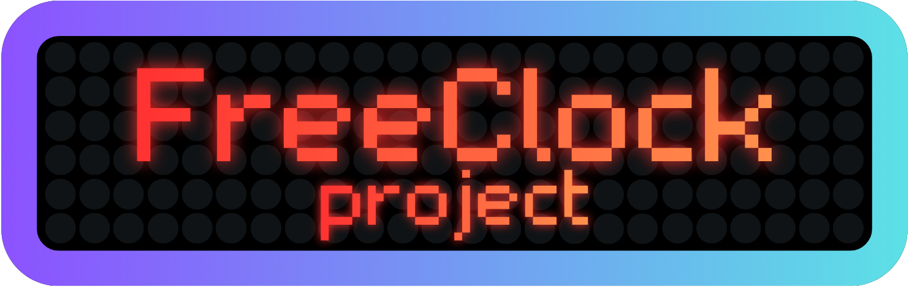
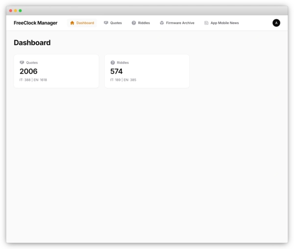

<div align= "center">

⭐ **If you like this project, star the repository!** ⭐ <br>
------- 🇮🇹 **[Readme in Italian][readme-it-url]** 🇮🇹 --------

<hr />
</div>

<div align="center">
<h2>FreeClock Manager</h2>

[](#)
[](#)
[](#)

<hr />

<a href="https://github.com/Matese-Makers/FreeClock">

</a>

<p><em>This software is part of the <a href="https://github.com/Matese-Makers/FreeClock"><strong>FreeClock</strong></a> project — an open source smart clock that's easy to assemble, with a 3D-printable case and a mobile app for management. Build your own and join the project!</em></p>


</div>

## 💡 Overview

FreeClock Manager is a web app for managing and distributing **quotes** and **riddles** via API.\
It is used for the **FreeClock project**, where it handles both OTA device updates and mobile app news... but it can also be used standalone for your own projects.

### 🌍 Multilanguage Support
- 🇮🇹 Italian (default language)
- 🇬🇧 English
- 🔄 Quotes and riddles filtered by language (`locale` column on categories)
- 🔄 Firmware and News translatable via `spatie/laravel-translatable`
- 🗂️ Translation tabs in admin panel (Filament Translatable Tabs)
- 🔗 API with language parameter support (Italian by default)

### 🛡️ Admin Panel (Filament v3)
- 🔐 Login with configurable email domain restriction
- 🎨 Amber theme with top navigation
- 📊 Dashboard widgets with quote and riddle count by language
- 🔍 Search, filters and sorting on all resources
- 🗑️ Bulk actions (multiple deletion)
- 📝 Rich Text Editor with custom toolbar

### 💬 Quote Management
- 📚 Quote archive with full CRUD
- 🏷️ Categories with language assignment
- 📆 Daily quote scheduling by date and language
- 🔁 No repetition within the calendar year
- 🔎 Filters by category and language

### 🧩 Riddle Management
- 📚 Riddle archive (text + answer) with full CRUD
- 🏷️ Categories with language assignment
- 📆 Daily riddle scheduling by date and language
- 🔁 No repetition within the calendar year
- 🔎 Filters by category and language

### 📡 Firmware Management
- 📦 Upload and download `.bin` binary files
- 🔢 Numeric versioning by device code
- ✅ Active/inactive toggle for publishing
- 📝 Translatable release notes (IT/EN)
- 🏷️ Translatable firmware name (IT/EN)

### 📰 News Management
- ✍️ Translatable title and content (IT/EN)
- 🖼️ Image upload with built-in editor and automatic resizing (1200×800)
- 🖼️ Automatic thumbnail generation (300×200)
- 📋 Automatic summary (first 150 characters without HTML)
- 📅 Publish/draft system with scheduled date
- 🧹 Automatic image cleanup on deletion (Observer pattern)

### 🔗 REST API
- `GET /api/daily/quote/{lang?}` — quote of the day
- `GET /api/daily/riddle/{lang?}` — riddle of the day
- `GET /api/news?lang=` — paginated news list
- `GET /api/news/{id}?lang=` — single news item
- `GET /api/fw/ver?device=` — firmware version (text)
- `GET /api/fw/ver_mobile?device=&lang=` — firmware version + notes (JSON)
- `GET /api/fw/dl?device=` — firmware binary download

### 🏠 Public Dashboard
- 🕐 Flip clock
- 📅 Date formatted in current language
- 🌈 Background slideshow with animated gradients
- 💬 **Quote of the day** — randomly selected, unique throughout the year
- 🧩 **Riddle of the day** — with solution hidden until 6:00 PM
- 📱 Responsive design (mobile, tablet, desktop)
- 🪟 Glassmorphism style with blur effects

### ⚙️ Tech Stack
- 🐘 Laravel 11 + PHP 8.2+
- 🧱 Filament v3
- 🗄️ SQLite (dev) / MySQL 8.0 (production)
- 🐳 Laravel Sail (Docker) for development
- 🐳 ServerSideUp (Docker) for deployment
- 📦 Spatie Laravel Translatable
- 🖼️ Intervention Image
- 🌱 **Seeder: initial archive with quotes and riddles in both Italian and English (updatable via JSON)**

## 🚀 Getting Started - Docker Compose

The easiest way to start FreeClock Manager is via Docker Compose, pulling the prebuilt image from Docker Hub.

1. **Create a folder and download the example `.env` file:**

   ```bash
   mkdir freeclock-manager && cd freeclock-manager
   curl -o .env https://raw.githubusercontent.com/luigirossidev/freeclock-manager/main/.env.prod
   ```

2. **Configure the `.env` file:**

   Open `.env` and change at least these values:
   ```dotenv
   # URL of your instance
   APP_URL=http://localhost
   ASSET_URL=http://localhost

   # Access port
   APP_PORT=8080

   # Language: it or en
   APP_LOCALE=it

   # Set to 1 to populate the database with quotes, riddles and demo admin user
   FIRST_SEED=1

   # After the first boot, set the email domain to restrict admin panel access
   # ADMIN_EMAIL_DOMAIN=@yourdomain.com
   ```

3. **Create the `docker-compose.yml` file:**

   ```yaml
   services:
     freeclock-manager_webapp:
       image: luigirossidev/freeclock-manager:latest
       restart: unless-stopped
       ports:
         - '${APP_PORT:-8080}:8080'
       environment:
         AUTORUN_ENABLED: "true"
         PHP_MEMORY_LIMIT: 1024M
         PHP_OPCACHE_ENABLE: 1
         PHP_SESSION_COOKIE_SECURE: 0
         PHP_POST_MAX_SIZE: "50M"
         PHP_UPLOAD_MAX_FILE_SIZE: "50M"
         SSL_MODE: "off"
         PHP_FPM_POOL_NAME: "freeclock-manager_core"
       volumes:
         - .env:/var/www/html/.env
         - freeclock-storage:/var/www/html/storage
         - freeclock-data:/var/www/html/database/data
       healthcheck:
         test: ["CMD-SHELL", "curl -s http://127.0.0.1:8080/healthcheck | grep -q OK || exit 1"]
         start_period: 5s
         interval: 10s
         timeout: 10s
         retries: 3

   volumes:
     freeclock-data:
     freeclock-storage:
   ```

4. **Start the container:**

   ```bash
   docker compose up -d
   ```

   On first boot, the following will run automatically:
   - `APP_KEY` generation (if not present)
   - Database migrations
   - Seeding with initial data (if `FIRST_SEED=1`)

5. **Access the application:**

   ```
   Dashboard:    http://localhost:8080
   Admin panel:  http://localhost:8080/admin

   Username: admin@admin.com
   Password: password
   ```

   > **Important:** after the first login, change the admin credentials and set `ADMIN_EMAIL_DOMAIN` in `.env` for security.

## 📦 Local Development

The project uses Laravel Sail for local development. Make sure you have **Docker** installed.

1. **Clone the repository:**

   ```bash
   git clone https://github.com/luigirossidev/freeclock-manager.git
   cd freeclock-manager
   ```

2. **Copy the configuration file:**

    ```bash
    cp .env.example .env
    ```

3. **Install dependencies:**

    ```bash
    docker run --rm \
            -u "$(id -u):$(id -g)" \
            -v "$(pwd):/var/www/html" \
            -w /var/www/html \
            laravelsail/php84-composer:latest \
            composer install --ignore-platform-reqs
    ```

4. **Start the Docker containers:**

    ```bash
    ./vendor/bin/sail up -d
    ```

5. **Generate the application key:**

    ```bash
    ./vendor/bin/sail artisan key:generate
    ```

6. **Run migrations with seeds (demo admin user, quotes and riddles archive):**

    ```bash
    ./vendor/bin/sail artisan migrate --seed
    ```

7. **Visit the URLs and enjoy!**

    ```bash
    http://localhost  
    http://localhost/admin  
   
    username: admin@admin.com  
    password: password
    ```


## 🤝 Contributing

Contributions are welcome! Here's how you can help:

1. **Fork** the repository
2. **Create** a feature branch (`git checkout -b feature/my-feature`)
3. **Commit** your changes (`git commit -m 'Add my feature'`)
4. **Push** to the branch (`git push origin feature/my-feature`)
5. **Open** a Pull Request

Please make sure your code follows the existing project style and that all features work correctly before submitting a PR.

For bug reports or feature requests, please [open an issue](https://github.com/luigirossidev/freeclock-manager/issues).

## 📄 License

This project is licensed under the **GNU Affero General Public License v3.0 (AGPL-3.0)**.

This means you are free to use, modify, and distribute this software, provided that:
- Any modified version that is made available over a network must also be released under the same license
- The source code must be made available to users who interact with the software over a network

For the full license text, see the [LICENSE](LICENSE) file.

<!--URL for Links-->
[trouble-shooting-url]: https://github.com/devyoujin/awesome-readme-template/issues
[license-url]: LICENSE
[readme-en-url]: README.md
[readme-it-url]: README.it.md
[serversideup-url]: https://github.com/serversideup/docker-php
